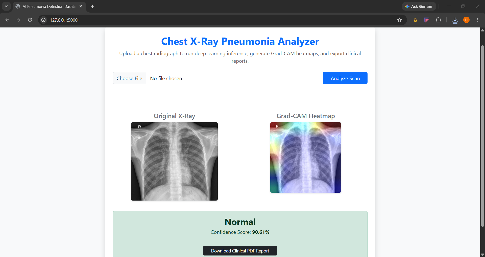

# 🩺 AI-Powered Chest X-Ray Pneumonia Detection & Clinical Reporting System

A full-stack deep learning web application built to assist in the early screening and diagnostic analysis of chest radiographs for Pneumonia. The system leverages **ResNet50 transfer learning**, **fine-tuning**, **class weight balancing**, **Grad-CAM explainability**, and generates downloadable **PDF clinical diagnostic reports**.

---

## 📸 Application Interface & Visual Workflow
Below is a preview of the web dashboard analyzing a chest X-ray and generating Grad-CAM attention heatmaps:

<p align="center">
  
</p>

---

## 🚀 Key Features

1. **High-Accuracy ResNet50 Architecture with Fine-Tuning:**
   - **Phase 1:** Feature extraction training on the classification head with frozen base layers.
   - **Phase 2:** Advanced fine-tuning by unfreezing deeper layers of ResNet50 (`conv5_block3`) with a reduced learning rate to capture complex pulmonary opacities.
2. **Class Imbalance Handling:** 
   - Utilizes `scikit-learn`'s computed class weights to handle dataset skewness between Normal and Pneumonia classes.
3. **Explainable AI (Grad-CAM):**
   - Generates visual heatmaps superimposed on original X-rays using OpenCV (`cv2.applyColorMap`) to highlight the regions the model focused on during prediction.
4. **Automated Clinical PDF Reporting:**
   - Powered by `ReportLab` to instantly export professional medical diagnostic reports containing prediction confidence scores, visual scan comparisons, and clinical explanations.
5. **Robust Training Logs:**
   - Integrated `CSVLogger` to record epoch-wise metrics (`loss`, `accuracy`, `precision`, `recall`) into `logs/training_log.csv`.

---

## 🛠️ Tech Stack
* **Backend & Framework:** Python, Flask, TensorFlow / Keras
* **Computer Vision & Image Processing:** OpenCV, NumPy, Matplotlib, Pillow
* **PDF Report Generation:** ReportLab
* **Frontend UI:** HTML5, Bootstrap 5
* **Data Processing & ML Utilities:** Scikit-learn (`compute_class_weight`), SciPy

---

## 📁 Project Directory Structure
```text
pneumonia-detection-app/
│
├── Assets/
│   └── UI.png                   # Web application interface screenshot
├── data/                        # Dataset directory (train / val) [Ignored in git]
├── logs/
│   └── training_log.csv         # Epoch training metrics log
├── models/
│   └── pneumonia_resnet50.keras   # Saved trained deep learning model weights
├── src/
│   ├── __init__.py
│   ├── preprocessing.py         # Image resizing, normalization pipeline
│   ├── train.py                 # 2-phase training script with callbacks & class weights
│   ├── gradcam.py               # Grad-CAM heatmap generation & superposition
│   └── report_generator.py      # ReportLab PDF clinical report compiler
├── static/
│   ├── uploads/                 # User-uploaded X-ray scans
│   ├── heatmaps/                # Generated Grad-CAM heatmaps
│   └── reports/                 # Downloadable PDF reports
├── templates/
│   └── index.html               # Frontend Flask dashboard template
├── venv/                        # Python virtual environment
├── .gitignore                   # Git exclusion rules
├── app.py                       # Flask application entry point
├── README.md                    # Project documentation
└── requirements.txt             # Project dependencies
